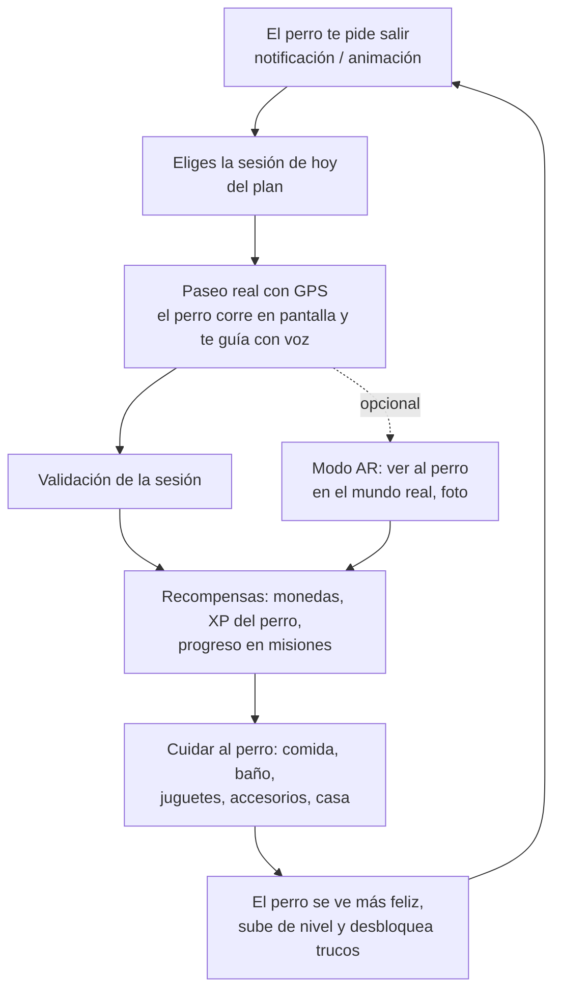

# 1. Producto y mecánicas

## 1.1 Visión

Convertir el "tengo que salir a correr" en "tengo que sacar a mi perro". La obligación cariñosa hacia una mascota es un motivador muy fuerte; Huellitas la usa para crear el hábito de moverse, empezando por caminar y llegando a correr de forma segura y progresiva.

### Objetivos del producto

| Objetivo | Métrica | Meta a 6 meses del lanzamiento |
|----------|---------|-------------------------------|
| Crear hábito | Usuarios con ≥ 2 paseos/semana durante 4 semanas | 35 % de los registrados |
| Retención | Retención día 30 | ≥ 25 % |
| Progreso | Usuarios que completan la Etapa 1 (0 → 5 km) | ≥ 15 % de quienes la inician |
| Seguridad | Reportes de lesión atribuibles al plan | 0 graves; tasa de "dolor" < 3 % de sesiones |

## 1.2 Usuarios (personas)

| Persona | Perfil | Necesidad | Qué le damos |
|---------|--------|-----------|--------------|
| **Ana, 34** | Sedentaria, trabajo de oficina, ama a los perros | Empezar sin sentirse juzgada | Etapa 0 (caminar), tono amable, metas pequeñas |
| **Luis, 47** | Sobrepeso, rodilla sensible | Ejercicio de bajo impacto | Plan adaptado de bajo impacto, alertas de dolor |
| **Sofía, 22** | Ya trota a veces, se aburre | Motivación y variedad | Misiones, coleccionables, AR, retos semanales |
| **Marta, 63** | Jubilada, quiere mantenerse activa | Seguridad y claridad | Plan 60+, textos grandes, modo de alto contraste |
| **Diego, 29** | Quiere su primer 10 km | Estructura | Etapas 2-3 con progresión clara |

## 1.3 Bucle principal de juego

### Bucles secundarios

- **Diario:** revisar al perro, darle de comer, misión diaria.
- **Semanal:** completar las 3 sesiones del plan, reto semanal, cofre de la semana.
- **Largo plazo:** avanzar de etapa, evolución estética del perro (de cachorro a adulto), colección de razas, accesorios y lugares.

## 1.4 La mascota

### Adopción
En el registro el usuario **adopta** un cachorro: elige raza inicial (6 al lanzamiento: mestizo, labrador, beagle, husky, salchicha, galgo), nombre, color y collar. Más razas se desbloquean con progreso (no con dinero real en el MVP).

### Estadísticas del perro

| Estado | Sube con | Baja con | Efecto |
|--------|----------|----------|--------|
| **Energía de paseo** (ganas de salir) | — | Se acumula con el tiempo | Cuando está alta, el perro pide salir; un paseo la descarga |
| **Hambre** | Comida | Tiempo y actividad | Perro con hambre está menos animado (solo visual) |
| **Felicidad** | Paseos, juguetes, caricias | Días sin salir (lento) | Desbloquea animaciones y trucos |
| **Higiene** | Baño, cepillado | Paseos (sobre todo con lluvia/barro) | Visual: perro sucio, divertido de bañar |
| **Vínculo** (permanente) | Cada paseo completado y cada día de cuidado | Nunca baja | Nivel del perro, trucos, evolución |

**Reglas éticas de diseño:**
- El perro **nunca muere, enferma ni se escapa**. El peor estado es "triste y aburrido" y se recupera con un solo paseo o un día de cuidado.
- Los **días de descanso del plan** ponen al perro en modo "siesta feliz": no se penaliza descansar.
- Si el usuario reporta dolor o se salta varios días por enfermedad, se activa el **modo pausa**: el perro espera tranquilo y los estados se congelan.

### Progresión del perro
- Niveles de vínculo 1-50. Cada 5 niveles: nuevo truco (sentarse, dar la pata, rodar, atrapar disco…), usable en la casa y en AR.
- Evolución visual: cachorro (Etapas 0-1) → joven (Etapa 2) → adulto (Etapa 3+). Opcional mantener aspecto de cachorro.

## 1.5 El paseo (sesión GPS)

1. **Previa:** el perro muestra la sesión del día ("5 × 1 min trotando / 1,5 min caminando"), consejos de calentamiento y el clima.
2. **Durante:**
   - Mapa con la ruta y el perro animado corriendo al ritmo del usuario.
   - **Guía por voz** (y vibración) para cambiar entre caminar y trotar: "¡Max quiere correr! Trota 1 minuto".
   - Indicadores grandes: tiempo, intervalo actual, distancia, ritmo.
   - **Test del habla:** recordatorio de que debe poder hablar en frases cortas.
   - Botón visible "**Me duele / no me siento bien**": termina la sesión, guarda lo hecho, ofrece consejos y ajusta el plan.
   - Hallazgos en la ruta: "huesos" y "pelotas" virtuales en puntos de la ruta (generados cerca del recorrido, nunca en calles peligrosas: solo se colocan sobre caminos peatonales/parques según datos de mapa).
3. **Después:** estiramientos guiados por el perro, autoevaluación de esfuerzo (RPE 1-10, con caritas), resumen, recompensas animadas.

## 1.6 Misiones

| Tipo | Ejemplos | Recompensa típica |
|------|----------|-------------------|
| **Diarias** (3) | Dar de comer al perro; caminar 10 min; tomar agua (autodeclarado) | 10-30 monedas |
| **De plan** | Completar la sesión de hoy; completar la semana | 50 / 150 monedas + cofre |
| **Semanales** | 3 paseos esta semana; 1 paseo antes de las 9:00; explorar una ruta nueva | 100-200 monedas |
| **Exploración** | Recoger 5 huesos en la ruta; visitar un parque | Objetos coleccionables |
| **AR** | Tomar una foto con tu perro en un parque; enseñarle un truco en AR | Accesorios exclusivos |
| **Hitos** | Primer km seguido corriendo; primeros 5 km; 30 días de racha flexible | Insignias, razas, cosméticos |
| **Temporada** (Fase 2+) | Eventos temáticos (Halloween, verano) | Cosméticos de temporada |

**Racha flexible:** la racha cuenta *semanas* en las que se cumplió el plan, no días seguidos. Incluye 1 "comodín" mensual. Evita la presión de entrenar todos los días.

## 1.7 Economía

### Monedas
- **Huesos de oro (moneda blanda):** se ganan jugando. Única moneda del MVP.
- **Sin compras con dinero real en el MVP.** Si en el futuro se monetiza, será con suscripción premium (planes avanzados, más razas) y cosméticos; nunca vender progreso del plan ni ventajas de salud.

### Fuentes (por usuario activo típico, 3 sesiones/semana)

| Fuente | Monedas aprox./semana |
|--------|----------------------|
| Sesiones del plan (3 × 50) | 150 |
| Semana completada | 150 |
| Misiones diarias | ~120 |
| Misiones semanales | ~150 |
| Huesos en ruta / AR | ~50 |
| **Total** | **~620** |

### Sumideros

| Categoría | Ejemplos | Precio |
|-----------|----------|--------|
| Comida (consumible) | Croquetas (10), comida premium (40), premio (15) | 10-40 |
| Higiene (consumible) | Champú (20), cepillo (permanente, 120) | 20-120 |
| Juguetes | Pelota, cuerda, disco (desbloquea truco) | 60-250 |
| Accesorios (cosméticos) | Collares, pañuelos, gorras, impermeables, zapatitos | 150-900 |
| Casa | Camas, cuencos, alfombras, decoración, fondos | 200-1500 |
| Mejoras de paseo | Correa luminosa (efecto visual en mapa), "silbato" de voz diferente | 300-800 |

Reglas:
- **Límite diario** de monedas por actividad física (p. ej. 300/día) para no incentivar sobreesfuerzo.
- Las monedas por sesión **no dependen de la velocidad ni la distancia**, sino de completar la sesión planificada (o al menos el 70 %).
- Todos los precios y recompensas viven en una **tabla de configuración en servidor** para ajustar el balance sin publicar versión.

## 1.8 Realidad aumentada

| Función | Descripción | Fase |
|---------|-------------|------|
| **Ver a mi perro** | Coloca al perro 3D en el suelo, a escala real; puede caminar, sentarse, hacer trucos | 2 |
| **Foto con mi perro** | Captura y comparte (marca de agua de la app) | 2 |
| **Caza de huesos AR** | En el paseo, al acercarse a un hueso (< 20 m) se puede abrir la cámara y "recogerlo" | 2 |
| **Juego de lanzar la pelota** | Mini juego AR en la casa o parque | 3 |

La AR es **opcional y nunca obligatoria durante la carrera** (seguridad: no mirar la cámara mientras se corre). Las misiones AR piden detenerse primero; si el GPS detecta movimiento > 6 km/h se muestra el aviso "detente para usar la cámara".

## 1.9 Funciones sociales (Fase 3)

- Amigos y "parque de perros": ver los perros de amigos, enviar premios (regalo de monedas limitado).
- Paseos en grupo (sesión compartida en tiempo real).
- Clasificaciones **por constancia** (sesiones completadas), nunca por velocidad, en el lanzamiento social.

## 1.10 Fuera de alcance del MVP

Compras con dinero real, chat, integración con relojes, rutas sugeridas automáticas, planes de maratón completa, multilenguaje más allá de español (preparar i18n desde el inicio; inglés en Fase 2).
