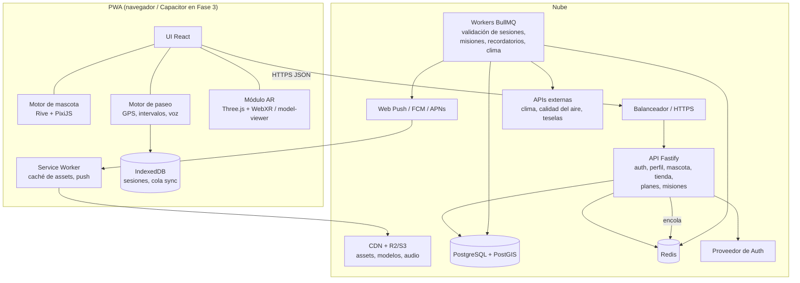
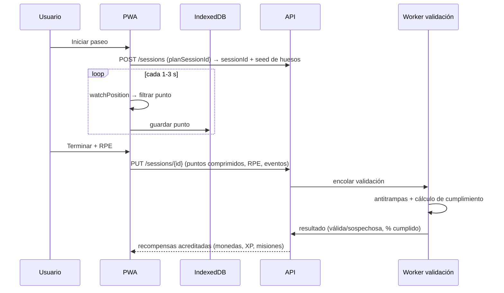
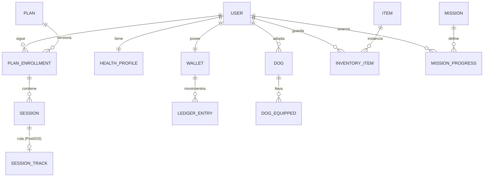

# 3. Arquitectura e infraestructura

## 3.1 Principios

1. **Un solo código para iOS, Android y escritorio** (PWA), preparado para envolverse con Capacitor sin reescribir.
2. **Offline primero durante el paseo:** la sesión nunca depende de la red; se sincroniza al terminar.
3. **El servidor es la fuente de verdad** de monedas, inventario y progreso (el cliente solo propone).
4. **Contenido como datos:** planes, misiones, tienda y balance económico se configuran sin publicar versión.
5. **Privacidad por diseño:** la ubicación y la salud son datos sensibles.

## 3.2 Stack recomendado

| Capa | Tecnología | Por qué |
|------|-----------|---------|
| Lenguaje | **TypeScript** en todo (front, back, compartido) | Tipos compartidos de dominio; mismo stack que el resto de proyectos del repo |
| Monorepo | npm workspaces (o pnpm) + Turborepo | `apps/web`, `apps/api`, `apps/workers`, `packages/domain`, `packages/content` |
| Frontend | **React 19 + Vite**, React Router, TanStack Query, Zustand | Ecosistema maduro, buen rendimiento, PWA con `vite-plugin-pwa` (Workbox) |
| Estilos / UI | Tailwind CSS + componentes propios (Radix UI como base accesible) | Rapidez y un sistema de diseño consistente |
| Animación 2D del perro | **Rive** (máquinas de estado: idle, feliz, triste, comer, correr…) | Animaciones vectoriales ligeras e interactivas, diseñadas por el animador sin código |
| Escenas 2D (casa, mapa estilizado) | **PixiJS 8** (WebGL/WebGPU) | Sprites, partículas (monedas, confeti) a 60 fps |
| Microinteracciones UI | Motion (Framer Motion) + Lottie para efectos puntuales | Transiciones de pantalla, botones, recompensas |
| Mapas | **MapLibre GL JS** + teselas vectoriales (MapTiler / Stadia / auto‑hospedadas con Protomaps) | Estilo de mapa personalizado "caricatura", sin depender de Google Maps |
| 3D / AR | **Three.js** (o react-three-fiber) + WebXR; **`<model-viewer>`** para AR Quick Look en iOS | Ver §3.5 |
| Voz | Clips de audio pregrabados (voz del "entrenador") + Web Speech API como respaldo | Indicaciones de intervalos fiables sin red |
| Almacenamiento local | IndexedDB (Dexie) | Puntos GPS, sesión en curso, cola de sincronización |
| Backend API | **Node.js 22 + Fastify**, validación con Zod, OpenAPI generado | Rápido, tipado, mismo lenguaje |
| ORM / migraciones | Drizzle ORM (o Prisma) | Migraciones versionadas y reversibles |
| Base de datos | **PostgreSQL 16 + PostGIS** | Rutas, geocercas, "huesos" en el mapa, consultas espaciales |
| Caché / colas | **Redis** + BullMQ | Límites de tasa, colas de validación de sesiones, clasificaciones |
| Autenticación | Servicio gestionado (Supabase Auth, Clerk o Auth0) con OAuth (Google, Apple) + enlace mágico por correo | No reinventar seguridad de cuentas |
| Archivos | Almacenamiento de objetos S3‑compatible (Cloudflare R2 / S3) + CDN | Modelos 3D, sprites, audio, fotos AR |
| Notificaciones | Web Push (VAPID); en Fase 3 FCM/APNs vía Capacitor | Recordatorios "tu perro quiere salir" |
| Clima / aire | API de clima (p. ej. Open‑Meteo) consultada desde el backend con caché | Adaptación de sesiones por calor y calidad del aire |
| Observabilidad | Sentry (errores front/back), OpenTelemetry + Grafana/Loki, analítica de producto (PostHog) | Errores, rendimiento y embudos |

### Alternativa más rápida para el MVP

Usar **Supabase** completo (Postgres + PostGIS + Auth + Storage) y solo un servicio Fastify para la lógica de juego. Reduce operación al inicio; la arquitectura sigue igual porque Supabase es Postgres estándar y se puede migrar.

## 3.3 Diagrama de componentes

## 3.4 GPS y seguimiento del paseo

### Implementación en la PWA
- `navigator.geolocation.watchPosition` con `enableHighAccuracy: true`, `maximumAge: 0`.
- **Screen Wake Lock API** para mantener la pantalla encendida durante el paseo + "modo bolsillo" (pantalla negra con brillo mínimo, solo un indicador, para ahorrar batería).
- Filtro de puntos en cliente: descartar `accuracy > 30 m`, saltos imposibles (> 12 m/s entre puntos), y suavizado con filtro de Kalman simple.
- Cálculo de distancia con Haversine; ritmo con media móvil de 30 s.
- **Los intervalos se basan en tiempo**, no en GPS, así la guía funciona aunque la señal sea mala.
- Cada punto se escribe en IndexedDB al instante; si la app se cierra, la sesión se recupera al volver.

### Limitación crítica y mitigación

| Problema | Impacto | Mitigación |
|----------|---------|-----------|
| Los navegadores **suspenden la geolocalización en segundo plano** o con pantalla apagada (sobre todo en iOS) | Rutas cortadas, distancias incorrectas | MVP: Wake Lock + modo bolsillo + aviso claro en el onboarding; detección de huecos y relleno por tiempo (la sesión cuenta por tiempo cumplido). Fase 3: app con **Capacitor** y plugin de geolocalización en segundo plano |
| Consumo de batería | Usuarios abandonan | Modo bolsillo, sin AR durante el paseo, reducción de frecuencia de render del mapa a 1 fps en modo bolsillo |
| Permisos denegados | No hay paseo | Modo "cinta / interior": sesión solo por tiempo, recompensa reducida (60 %) y sin huesos en ruta |

### Flujo de una sesión

Si no hay red al terminar, la sesión queda en la cola de IndexedDB y el Service Worker la envía con **Background Sync** (donde exista) o al reabrir la app. Las recompensas se muestran como "pendientes" hasta la validación.

## 3.5 Realidad aumentada

| Plataforma | Técnica | Capacidades |
|-----------|---------|-------------|
| Android + Chrome (ARCore) | **WebXR `immersive-ar`** + hit-test + anchors (Three.js) | Perro en el suelo, a escala, animado, interacción por toque, foto |
| iOS Safari | **AR Quick Look** vía `<model-viewer>` con modelo USDZ | Ver al perro en el entorno con animación predefinida; foto desde el visor del sistema |
| Cualquier dispositivo | **Modo cámara superpuesta**: `getUserMedia` + perro 2D/3D renderizado encima, orientado con `DeviceOrientation` | Fallback universal: foto con el perro, caza de huesos |
| Escritorio | Visor 3D interactivo | Ver y vestir al perro |

Recursos 3D:
- Modelos **glTF/GLB** (WebXR/three) y **USDZ** (iOS), generados desde la misma fuente en Blender.
- Presupuesto: ≤ 15 000 triángulos por perro, texturas 1024² comprimidas (KTX2/Basis), GLB ≤ 2 MB con Draco/meshopt.
- Accesorios como mallas acopladas a huesos del esqueleto (un esqueleto común por tamaño de raza: pequeño, mediano, grande).
- Detección de capacidades al cargar: `navigator.xr?.isSessionSupported('immersive-ar')` → elegir modo.

## 3.6 Modelo de datos (núcleo)

| Tabla | Campos clave |
|-------|-------------|
| `users` | id, auth_id, display_name, locale, timezone, created_at, deleted_at |
| `health_profiles` | user_id, parq_answers (cifrado), conditions (cifrado), medical_clearance_at, consent_version |
| `dogs` | id, user_id, name, breed, colors, stage_look, bond_xp, level, hunger, happiness, hygiene, walk_energy, stats_updated_at |
| `plans` / `plan_versions` | id, code, version, content (JSONB), variants |
| `plan_enrollments` | user_id, plan_version_id, variant, days_per_week, current_week, current_session, status |
| `sessions` | id, user_id, enrollment_id, plan_session_ref, started_at, ended_at, duration_s, distance_m, rpe, pain_flag, completion_pct, validation_status, mode (gps/indoor) |
| `session_tracks` | session_id, geom (`LINESTRING`, SRID 4326), raw_points (comprimido), simplified_geom |
| `wallets` | user_id, balance (derivado, con versión para bloqueo optimista) |
| `ledger_entries` | id, user_id, amount (+/−), reason, ref_type, ref_id, **idempotency_key único**, created_at |
| `items` | id, sku, category, price, consumable, effects (JSONB), rarity, active_from/to |
| `inventory_items` | user_id, item_id, quantity |
| `dog_equipped` | dog_id, slot (cuello, cabeza, cuerpo, patas, casa_*), item_id |
| `missions` | id, type (daily/weekly/plan/ar/milestone), criteria (JSONB), reward, schedule |
| `mission_progress` | user_id, mission_id, period_key, progress, completed_at, claimed_at |
| `route_collectibles` | id, session_id, geom (`POINT`), kind, collected_at |
| `remote_config` | key, value (JSONB), version — balance económico, límites, feature flags |

Notas:
- **Libro contable (ledger) inmutable** para monedas: el saldo se deriva de los movimientos; cada recompensa usa una `idempotency_key` (p. ej. `session:{id}:complete`) para que nunca se pague dos veces.
- Las estadísticas del perro (hambre, felicidad…) se **calculan perezosamente** a partir de `stats_updated_at` y el tiempo transcurrido, en vez de actualizar con un cron cada usuario.

## 3.7 API (REST, versión `/v1`)

| Método | Ruta | Uso |
|--------|------|-----|
| GET | `/me` | Perfil, estado del perro, saldo, resumen del día |
| PUT | `/me/health-profile` | Cuestionario y condiciones (cifrado) |
| POST | `/dogs` | Adoptar |
| PATCH | `/dogs/{id}` | Nombre, apariencia |
| POST | `/dogs/{id}/actions` | `feed`, `bathe`, `play`, `pet` (consume inventario) |
| GET | `/plans`, `/plans/{code}` | Catálogo |
| POST | `/enrollments` | Inscribirse a una etapa/variante |
| GET | `/enrollments/current/today` | Sesión del día con instrucciones |
| POST | `/sessions` | Iniciar (devuelve semilla de coleccionables cercanos) |
| PUT | `/sessions/{id}` | Finalizar y subir ruta (idempotente) |
| GET | `/sessions?cursor=` | Historial |
| GET | `/missions` | Misiones activas y progreso |
| POST | `/missions/{id}/claim` | Reclamar recompensa |
| GET | `/shop` | Catálogo vigente |
| POST | `/shop/purchase` | Comprar (`Idempotency-Key` obligatorio) |
| PUT | `/dogs/{id}/equipment` | Equipar accesorios |
| POST | `/ar/captures` | URL firmada para subir foto AR |
| POST | `/push/subscriptions` | Registrar Web Push |
| DELETE | `/me` | Borrado de cuenta y datos (derecho de supresión) |
| GET | `/me/export` | Exportación de datos (incluye GPX de rutas) |

## 3.8 Antitrampas y validación de sesiones

Ejecutado en el worker; resultado: `valid`, `partial`, `suspicious`, `rejected`.

| Verificación | Regla |
|-------------|-------|
| Velocidad | Tramos > 25 km/h sostenidos > 20 s se excluyen (vehículo); si > 30 % de la sesión → `rejected` |
| Teletransporte | Saltos > 200 m entre puntos consecutivos |
| Densidad de puntos | Menos de 1 punto/15 s con señal buena → sospechoso |
| Coherencia temporal | Marcas de tiempo monótonas, no futuras, duración ≈ fin − inicio |
| Ubicación simulada | Precisión idéntica en todos los puntos, coordenadas con patrón sintético |
| Movimiento (opcional) | Cadencia del acelerómetro (`DeviceMotion`) compatible con caminar/correr |
| Límites | Máx. 2 sesiones recompensadas/día, tope diario de monedas, enfriamiento entre compras |
| Coleccionables | Solo cuentan si la ruta pasa a < 25 m del punto generado por el servidor |

Las sesiones `suspicious` dan recompensa reducida y no cuentan para clasificaciones; nunca se acusa al usuario en la interfaz.

## 3.9 Seguridad

- HTTPS obligatorio (requerido también por Geolocation, cámara y Service Workers); HSTS; CSP estricta.
- JWT de corta duración del proveedor de auth, verificados en la API; refresh rotativo.
- Autorización por recurso (un usuario solo accede a sus perros, sesiones e inventario); pruebas automáticas de autorización.
- Validación de todas las entradas con Zod; límites de tamaño de carga (rutas ≤ 2 MB comprimidas).
- Límites de tasa por usuario e IP en Redis.
- Compras y recompensas transaccionales (`SERIALIZABLE` o bloqueo optimista sobre `wallets.version`) + claves de idempotencia.
- Secretos en el gestor del proveedor cloud, nunca en el repositorio.
- Fotos AR: URLs firmadas de subida, escaneo de tipo MIME, eliminación de metadatos EXIF (ubicación).

## 3.10 Privacidad y cumplimiento

- **Datos de ubicación y salud = sensibles.** Consentimiento explícito y separado para cada uno; política de privacidad clara en lenguaje sencillo.
- Cifrado en reposo (disco) + cifrado a nivel de columna para `health_profiles`.
- **Zonas de privacidad:** el usuario puede ocultar el inicio/fin de sus rutas (p. ej. 200 m alrededor de su casa); por defecto las rutas nunca son públicas.
- Retención: puntos GPS crudos 12 meses (después solo la ruta simplificada y métricas), configurable por el usuario.
- Exportación y borrado de cuenta en autoservicio.
- Revisar la normativa aplicable al mercado objetivo (p. ej. RGPD en la UE, LFPDPPP en México, leyes de protección de datos de cada país de Latinoamérica) y la edad mínima de uso (recomendado 16+; menores con consentimiento parental en una fase posterior).
- Descargo de responsabilidad médica y aceptación de términos en el onboarding.

## 3.11 Entornos y despliegue

| Entorno | Propósito | Infraestructura |
|---------|-----------|-----------------|
| `local` | Desarrollo | Docker Compose: Postgres+PostGIS, Redis, MinIO; Vite dev server con HTTPS local (mkcert) para probar GPS/cámara en el móvil |
| `dev` | Integración continua | Despliegue automático desde la rama principal; datos sintéticos |
| `staging` | Pruebas de aceptación y de campo | Igual que producción, a menor escala; datos anonimizados |
| `production` | Usuarios reales | Ver abajo |

Producción (opción recomendada, gestionada y con escala automática):
- **Frontend:** Cloudflare Pages / Vercel (estático + CDN global).
- **API y workers:** contenedores en Google Cloud Run, AWS App Runner/ECS Fargate o Fly.io (2+ instancias de API, workers escalados por longitud de cola).
- **Postgres gestionado** con PostGIS (Neon, Supabase, Cloud SQL o RDS) con copias automáticas y recuperación a un punto en el tiempo.
- **Redis gestionado** (Upstash, Memorystore o ElastiCache).
- **R2/S3 + CDN** para assets.
- Infraestructura como código con **Terraform** (u OpenTofu).

CI/CD (GitHub Actions):
1. En cada PR: lint, typecheck, pruebas unitarias e integración (Postgres en contenedor), build, análisis de dependencias vulnerables, Lighthouse CI (rendimiento PWA), presupuesto de tamaño de bundle.
2. Fusión a la rama principal → despliegue a `dev`.
3. Etiqueta de versión candidata → `staging` + pruebas E2E (Playwright con geolocalización simulada).
4. Aprobación manual → `production` con migraciones reversibles y despliegue gradual; reversión con un clic a la imagen anterior.

## 3.12 Rendimiento (presupuestos)

| Métrica | Meta |
|---------|------|
| JS inicial (comprimido) | ≤ 200 KB; AR, mapa y Pixi cargados bajo demanda |
| LCP en móvil medio 4G | ≤ 2,5 s |
| Animación del perro | 60 fps en gama media; 30 fps en gama baja (detección automática) |
| Consumo de batería en paseo de 30 min | ≤ 10 % en modo bolsillo |
| API p95 | ≤ 200 ms |

## 3.13 Costos estimados de infraestructura (orientativos)

| Escala | Usuarios activos mensuales | Costo mensual aprox. (USD) |
|--------|---------------------------|---------------------------|
| MVP / beta | < 1 000 | 50 – 150 (planes gratuitos/básicos) |
| Lanzamiento | ~10 000 | 300 – 800 |
| Crecimiento | ~100 000 | 2 000 – 5 000 (las teselas de mapa y el almacenamiento de rutas son los mayores costos) |

Valores de referencia que deben recalcularse con las tarifas vigentes de los proveedores elegidos.
