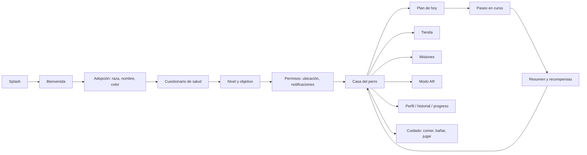

# 4. Diseño visual y UX

## 4.1 Dirección de arte

**"Cálido, juguetón y amable."** Estilo ilustrado 2D con formas redondeadas, contornos suaves y sombras planas, inspirado en libros infantiles modernos, combinado con modelos 3D estilizados (low‑poly suave, sin realismo) para la AR. Debe sentirse como un juego, no como una app de fitness seria.

Pilares:
1. **El perro es el protagonista** de cada pantalla (nunca un gráfico frío).
2. **Todo responde:** cada toque tiene una reacción (rebote, sonido suave, movimiento del perro).
3. **Celebrar siempre, culpar nunca:** recompensas exageradas y divertidas; mensajes empáticos cuando no se cumplió.
4. **Claridad durante la carrera:** en el paseo, la estética se simplifica a números grandes y alto contraste.

## 4.2 Paleta

| Rol | Color | Uso |
|-----|-------|-----|
| Primario | `#FF8A3D` naranja "pelota" | Botones principales, acentos |
| Secundario | `#3BB6A8` verde azulado "parque" | Progreso, éxito, mapa |
| Terciario | `#FFD166` amarillo "hueso de oro" | Monedas, recompensas |
| Acento | `#6C63FF` violeta | Misiones, AR, elementos especiales |
| Fondo claro | `#FFF8EF` crema | Fondo general |
| Texto | `#2E2A33` | Texto principal (contraste AA sobre crema) |
| Alerta | `#E5484D` | Dolor, errores (uso mínimo) |
| Modo oscuro | Fondo `#1E1B22`, superficies `#2A2630` | Paseos nocturnos y preferencia del sistema |

Todos los pares texto/fondo deben cumplir **WCAG 2.1 AA** (4,5:1 texto normal).

## 4.3 Tipografía

- Títulos: **Baloo 2** o **Fredoka** (redondeada, amistosa).
- Texto y números: **Nunito** (legible, cifras tabulares para métricas).
- Escala: 14 / 16 / 20 / 24 / 32 / 48; métricas del paseo 56-72 px.

## 4.4 Animación

| Tipo | Herramienta | Ejemplos |
|------|-------------|----------|
| Perro (estados) | Rive, máquina de estados con entradas `mood`, `hunger`, `hygiene`, `action` | idle (respira, mueve la cola, olfatea), feliz, triste, dormido, comer, bañarse, correr, trucos |
| Recompensas | PixiJS partículas + Lottie | lluvia de huesos de oro, confeti, cofre abriéndose |
| Transiciones | Motion | páginas que se deslizan, tarjetas con rebote (spring) |
| Mapa | MapLibre + capa Pixi | perro corriendo sobre la ruta, huellas que quedan atrás |

Reglas: duraciones 150-400 ms en UI; respetar `prefers-reduced-motion` (sustituir por fundidos); ninguna animación bloquea una acción.

## 4.5 Mapa de pantallas

Navegación inferior (5): **Casa · Plan · ¡Pasear! (botón central grande) · Misiones · Tienda**. Perfil y ajustes desde el avatar.

## 4.6 Pantallas clave

| Pantalla | Contenido | Interacciones |
|----------|-----------|---------------|
| **Casa** | Perro animado en su habitación (decorable); barras redondas de estado; bocadillo con lo que quiere ("¡Vamos al parque!"); saldo de monedas | Acariciar (arrastrar), tocar cuenco para dar comida, botón "pasear" que hace que el perro traiga la correa |
| **Plan de hoy** | Tarjeta de la sesión con la línea de intervalos dibujada como huellas; semana actual en un camino tipo mapa del tesoro; clima y consejo | Iniciar, cambiar a caminata suave, ver detalle de la semana |
| **Paseo** | Arriba: intervalo actual grande ("TROTA · 0:42") con color por tipo; centro: mapa con el perro; abajo: tiempo total, distancia, ritmo; botones pausa / "me duele" | Cuenta atrás 3-2-1 con ladrido, vibración en cambios, modo bolsillo con doble toque |
| **Resumen** | Ruta dibujada, métricas, RPE con caritas, perro celebrando, recompensas que caen en la cartera | Compartir tarjeta (sin mapa por defecto, por privacidad) |
| **Tienda** | Pestañas: comida, higiene, juguetes, ropa, casa; probador en vivo sobre el perro | Comprar con confirmación, equipar al instante |
| **Misiones** | Diarias, semanales, hitos; barras de progreso; cofres | Reclamar con animación |
| **AR** | Vista de cámara, retícula de suelo, perro aparece con salto; botones truco/foto | Toque para mover al perro, pellizco para girar |

## 4.7 Voz y tono

- El perro "habla" en primera persona con frases cortas y cariñosas; el entrenador (voz humana) da instrucciones de seguridad.
- Ejemplos:
  - Inicio: "¡Huelo aventuras! ¿Salimos?"
  - Cambio a trotar: "¡Max quiere correr! Trota suave un minuto."
  - Sesión fallida: "Hoy caminamos menos, ¡pero salimos juntos! Mañana lo intentamos otra vez."
  - Dolor: "Paremos aquí. Tu salud es lo primero. Max te espera para la próxima."
- Evitar: lenguaje de peso corporal, comparaciones, culpa, términos médicos alarmistas.

## 4.8 Accesibilidad

- WCAG 2.1 AA; botones táctiles ≥ 48 × 48 px.
- Todas las indicaciones del paseo disponibles por **voz, texto y vibración**.
- Lector de pantalla: el perro tiene descripciones de estado ("Max está feliz y un poco hambriento").
- Tamaño de texto ajustable y modo de alto contraste; modo daltonismo (los intervalos se distinguen también por icono y patrón, no solo por color).
- `prefers-reduced-motion` respetado.
- Modo de una mano durante el paseo.

## 4.9 Lista de recursos gráficos (MVP)

| Recurso | Cantidad | Formato | Responsable |
|---------|----------|---------|-------------|
| Razas de perro 2D animadas (cachorro) | 6 | Rive (.riv), ~20 estados cada una | Ilustrador + animador 2D |
| Variantes de color por raza | 3-4 por raza | Capas en Rive | Ilustrador |
| Accesorios 2D | 40 | SVG/Rive, por ranura | Ilustrador |
| Muebles y decoración de casa | 30 | PNG/WebP @2x y @3x, atlas | Ilustrador |
| Iconos de interfaz | ~60 | SVG | Diseñador UI |
| Efectos (monedas, confeti, cofre) | 8 | Lottie / partículas Pixi | Animador |
| Estilo de mapa personalizado | 1 claro + 1 oscuro | JSON de estilo MapLibre | Diseñador UI |
| Sonidos (ladridos, UI, recompensas) | ~40 | OGG/AAC cortos | Diseñador de sonido |
| Voz de entrenador (es) | ~120 frases | AAC | Locutor/a |
| Ilustraciones de onboarding y estados vacíos | 12 | SVG | Ilustrador |

Fase 2 (AR): 6 perros 3D riggeados (GLB + USDZ), 20 accesorios 3D, 3 animaciones de truco por perro.
