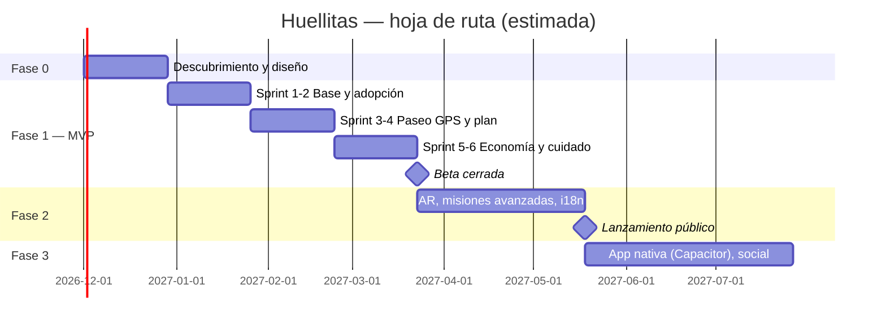

# 5. Plan de desarrollo

## 5.1 Equipo propuesto

| Rol | Dedicación | Responsabilidad |
|-----|-----------|-----------------|
| Product manager / dueño de producto | 1 | Priorización, métricas, balance de economía |
| Diseñador UX/UI | 1 | Flujos, sistema de diseño, prototipos, pruebas con usuarios |
| Ilustrador + animador 2D (Rive) | 1 | Perros, accesorios, efectos |
| Artista 3D | 0,5 (desde Fase 2) | Modelos GLB/USDZ, rigging, animaciones |
| Desarrolladores frontend | 2 | PWA, motor de paseo, mascota, AR |
| Desarrollador backend | 1 | API, workers, datos, antitrampas, infraestructura |
| QA (manual + automatización) | 1 (desde sprint 3) | Pruebas de campo con GPS real, E2E |
| Asesoría deportiva y de salud | Consultoría | Entrenador certificado, fisioterapeuta, médico: revisión de planes |
| Asesoría legal | Consultoría | Privacidad, términos, descargo médico |

Equipo mínimo alternativo (más lento, ~1,6× la duración): 1 full‑stack + 1 frontend/creative + 1 diseñador/ilustrador.

## 5.2 Fases y cronograma

Fechas orientativas suponiendo inicio el 1 de diciembre de 2026 y el equipo completo. Cada sprint = 2 semanas.

### Fase 0 — Descubrimiento (4 semanas)

- Entrevistas con 10-15 personas que quieren empezar a correr (y dueños de perros).
- Prototipo en Figma de onboarding, casa, paseo y tienda; prueba de usabilidad con 5-8 personas.
- **Pruebas técnicas (spikes) críticas:**
  1. GPS en PWA con Wake Lock en iPhone y Android de gama media: precisión, cortes, batería (30 min).
  2. Rendimiento de Rive + PixiJS en gama baja.
  3. WebXR en Android y `<model-viewer>` en iOS con un perro de prueba.
- Validación de planes con asesores de salud.
- Definición de marca, nombre definitivo (verificar disponibilidad de marca y dominio), estilo visual y primer perro animado.
- Repositorio, CI, entornos `local`/`dev`, Terraform base.

**Salida:** documento de requisitos aprobado, prototipo validado, resultados de spikes, backlog priorizado.

### Fase 1 — MVP (12 semanas, 6 sprints)

| Sprint | Objetivo | Entregables |
|--------|----------|-------------|
| **1** | Esqueleto | Monorepo, PWA instalable, auth (Google, Apple, correo), sistema de diseño base, API con `/me`, migraciones, despliegue a `dev` |
| **2** | Adopción y casa | Onboarding completo (incl. cuestionario de salud y consentimientos), adopción de 3 razas, casa con perro animado (idle, feliz, triste), estados con cálculo perezoso |
| **3** | Motor de paseo | GPS + filtros, IndexedDB, Wake Lock, modo bolsillo, temporizador de intervalos con voz y vibración, mapa con estilo propio |
| **4** | Planes | Contenido de Etapas 0 y 1 (base + bajo impacto + 2 días), plan de hoy, resumen con RPE, botón de dolor, reglas de adaptación, sincronización offline |
| **5** | Economía | Validación de sesiones en worker, antitrampas v1, ledger de monedas, misiones diarias/plan/hitos, recompensas animadas |
| **6** | Cuidado y tienda | Tienda (comida, higiene, juguetes, 20 accesorios), inventario, equipar, acciones de cuidado, 6 razas, notificaciones push, pulido, accesibilidad, analítica |

**Beta cerrada** (4 semanas en paralelo al inicio de Fase 2): 100-300 personas, con encuestas semanales y métricas de retención, batería y precisión de GPS.

### Fase 2 — AR y profundidad (8 semanas)

- AR: perro 3D (WebXR + Quick Look + modo cámara), fotos, caza de huesos en ruta.
- Etapas 2 y 3; variantes por condición restantes (tras revisión profesional).
- Misiones semanales, exploración y cofres; eventos de temporada (sistema).
- Ajustes de clima y calidad del aire.
- Inglés (i18n), modo oscuro, exportación GPX, borrado de cuenta en autoservicio (si no llegó en el MVP).
- **Lanzamiento público**.

### Fase 3 — Nativo y social (10 semanas)

- Envoltorio Capacitor (iOS/Android) con GPS en segundo plano, notificaciones nativas, HealthKit / Health Connect.
- Amigos, parque de perros, paseos en grupo, clasificaciones de constancia.
- Etapa 4 (media maratón) y modo Manada.
- Evaluación de monetización (suscripción premium cosmética/planes avanzados).

## 5.3 Definición de "terminado"

Una historia está terminada cuando:
1. Cumple sus criterios de aceptación.
2. Tiene pruebas unitarias y, si toca API o datos, de integración.
3. Pasa lint, typecheck y CI.
4. Cumple accesibilidad AA en las pantallas afectadas.
5. Funciona en Safari iOS y Chrome Android reales (no solo emuladores) cuando usa GPS, cámara o sensores.
6. Tiene eventos de analítica definidos.
7. Está desplegada en `dev` y revisada por el PM/diseño.

## 5.4 Estrategia de pruebas

| Nivel | Herramienta | Qué cubre |
|-------|-------------|-----------|
| Unitarias | Vitest | Dominio: reglas de adaptación de planes, cálculo de estados del perro, economía, filtros GPS, antitrampas |
| Contenido | Vitest + esquemas Zod | Todos los planes y misiones válidos; progresión de volumen ≤ 10 %/semana en Etapas 3-4 |
| Integración | Vitest + Postgres/Redis en contenedor | API, transacciones de monedas, idempotencia, autorización |
| E2E | Playwright (geolocalización y tiempo simulados) | Onboarding, sesión completa con ruta grabada, compra, misiones |
| Rutas reales | Biblioteca de trazas GPX reales (caminando, corriendo, bici, coche, falsificadas) | Precisión de distancia y detección de trampas |
| Rendimiento | Lighthouse CI, perfiles en dispositivos reales | Presupuestos de §3.12 |
| Campo | QA + beta testers | Paseos reales: iPhone y Android de gama baja/media/alta, ciudad/parque/árboles, día/noche |
| Usabilidad | Sesiones moderadas | Onboarding, comprensión de intervalos durante la carrera |

## 5.5 Métricas y analítica

Embudo: instalación → adopción → cuestionario → primer paseo → 3 paseos en la semana 1 → semana 4 completada → etapa completada.

Eventos clave: `dog_adopted`, `session_started`, `session_completed`, `session_pain_reported`, `interval_skipped`, `mission_claimed`, `item_purchased`, `ar_opened`, `push_opened`. Sin enviar ubicación ni datos de salud a la herramienta de analítica.

Paneles: retención D1/D7/D30, sesiones por usuario/semana, % de sesiones completadas, uso del botón de dolor, monedas generadas vs. gastadas (inflación), errores de GPS por modelo de dispositivo.

## 5.6 Riesgos

| Riesgo | Prob. | Impacto | Mitigación |
|--------|-------|---------|-----------|
| GPS en segundo plano no disponible en PWA (iOS) | Alta | Alto | Wake Lock + modo bolsillo, sesiones basadas en tiempo, Capacitor en Fase 3 (adelantable si la beta lo exige) |
| Lesiones o problemas de salud de usuarios | Media | Muy alto | Revisión profesional de planes, PAR-Q+, botón de dolor, progresión conservadora, descargo legal |
| Producción de arte más lenta que el código | Alta | Medio | Empezar arte en Fase 0, pipeline Rive reutilizable, MVP con 3 razas si es necesario |
| WebXR limitado en iOS | Alta | Medio | Quick Look + modo cámara superpuesta; AR no es requisito del MVP |
| Economía desbalanceada (inflación o escasez) | Media | Medio | Configuración remota, panel de monedas, simulación con hoja de cálculo antes de la beta |
| Trampas (GPS falso, coche) | Media | Bajo-Medio | Validación en servidor, topes diarios, recompensas por esfuerzo y no por distancia |
| Batería | Media | Alto | Modo bolsillo, carga diferida del mapa, pruebas de campo |
| Privacidad de rutas (domicilio) | Media | Alto | Zonas de privacidad por defecto, rutas privadas, retención limitada |
| Costos de teselas de mapa | Baja-Media | Medio | Teselas vectoriales autoalojadas (Protomaps/PMTiles) si el uso crece |

## 5.7 Presupuesto aproximado de esfuerzo

| Fase | Duración | Esfuerzo (persona‑semana) |
|------|----------|--------------------------|
| Fase 0 | 4 semanas | ~24 |
| Fase 1 | 12 semanas | ~90 |
| Fase 2 | 8 semanas | ~60 |
| Fase 3 | 10 semanas | ~70 |

Estimaciones gruesas, a refinar al final de la Fase 0 con el backlog detallado.

## 5.8 Próximos pasos inmediatos

1. Confirmar nombre, mercado inicial (país/idioma) y presupuesto.
2. Decidir si se usa Supabase (más rápido) o infraestructura propia desde el inicio.
3. Contratar/asignar ilustrador‑animador y asesoría de salud.
4. Ejecutar los 3 spikes técnicos de la Fase 0 (GPS, animación, AR).
5. Crear el repositorio del proyecto (separado de este repositorio) con el monorepo y CI base.
