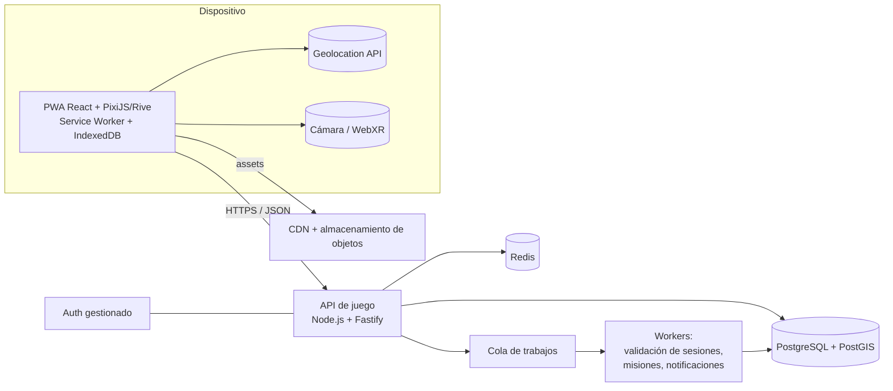

# Huellitas — tu perro te saca a correr

> Nombre de trabajo. Web app (PWA) que ayuda a personas sedentarias o principiantes a empezar a correr, usando una mascota virtual (un perro) que hay que sacar a pasear de verdad.

Estado: **planificación (Fase 0)**. Fecha: 2026-11-17.

## La idea en una frase

Tu perro virtual necesita salir. Cada paseo real (caminata o carrera, medida con GPS) lo hace feliz, te da monedas para cuidarlo y te hace avanzar en un plan de entrenamiento adaptado a ti.

## Documentos

| # | Documento | Contenido |
|---|-----------|-----------|
| 1 | [Producto y mecánicas](01-producto.md) | Visión, usuarios, bucle de juego, mascota, misiones, monedas, tienda, realidad aumentada |
| 2 | [Planes de entrenamiento](02-planes-entrenamiento.md) | Etapas (de caminar a media maratón), adaptaciones por condición física/salud, reglas de progresión y seguridad |
| 3 | [Arquitectura e infraestructura](03-arquitectura.md) | Stack, diagrama, GPS, AR, offline, modelo de datos, API, antitrampas, seguridad, privacidad, entornos y costos |
| 4 | [Diseño visual y UX](04-diseno-ux.md) | Dirección de arte, paleta, tipografía, animación, pantallas, accesibilidad, lista de recursos gráficos |
| 5 | [Plan de desarrollo](05-plan-desarrollo.md) | Fases, sprints, equipo, hitos, pruebas, métricas, riesgos |

## Decisiones clave (resumen)

1. **PWA primero, envoltorio nativo después.** Una web app instalable llega a iOS y Android con un solo código. La limitación crítica es que **el navegador no rastrea GPS con la pantalla apagada o la app en segundo plano**. En el MVP se resuelve con modo "paseo activo" (Wake Lock + pantalla de bajo consumo); en la Fase 3 se empaqueta con Capacitor para tener GPS en segundo plano y acceso a HealthKit / Health Connect.
2. **Realidad aumentada en dos niveles.** WebXR (`immersive-ar`) en Android/Chrome; en iOS, AR Quick Look vía `<model-viewer>` (USDZ) y un modo "cámara + perro superpuesto" como alternativa universal.
3. **Se premia el esfuerzo, no la velocidad.** Las monedas dependen de completar la sesión planificada, no de los kilómetros. Los días de descanso también cuentan: el perro "descansa contigo". Esto evita sobreentrenamiento y es justo para personas con condiciones de salud.
4. **El perro nunca muere ni sufre.** Si no sales, se aburre y te extraña, pero nunca hay castigos que generen culpa.
5. **Economía validada en servidor.** Las monedas solo se acreditan cuando el backend valida la sesión GPS (antitrampas).
6. **Seguridad de salud.** Cuestionario de aptitud (tipo PAR-Q+) en el registro; los planes para condiciones especiales requieren aviso de consulta médica y deben ser revisados por profesionales antes del lanzamiento.

## Arquitectura de un vistazo

